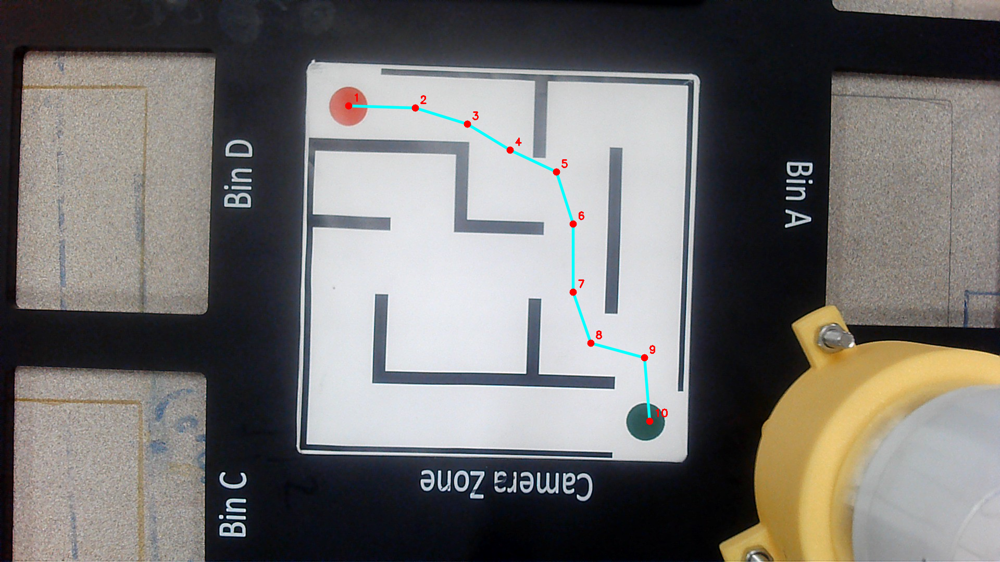

# RAS 545 Final Project — myCobot Pro 600 Maze Solver

In this ASU Robotics 1 team project, we used a camera image of a maze to compute waypoints for a myCobot Pro 600. The repository includes a Python maze generator and solver, a MATLAB motion script, and the robot's Simulink and CAD assets.

## Project files

- The Python solver processes the photographed maze and returns XY waypoints. [Solver](maze_solver.py) · [Camera image](unsolved_maze2.png)
- A separate Python script generates a maze image using Pillow. [Generator](maze_generator_9.py) · [Generated example](unsolved_maze.png)
- The MATLAB script calls the solver, checks for 10 waypoints, and maps them relative to the reference tool position. It contains TCP code for sending joint commands to the robot. [MATLAB script](final.m)
- Keep the Simulink model, parameter data, CAD import definition, and seven STEP geometry exports together under their original filenames. The SolidWorks assembly and its component parts are also included. [Model](cobot600.slx) · [Parameters](cobot600_DataFile.m) · [CAD import definition](cobot600.xml) · [SolidWorks assembly](Assem3.SLDASM)

## Offline verification

On the bundled camera image, the solver returned 10 finite XY waypoints within the image bounds. In the overlay, the nine straight segments run from the red start marker to the green goal marker with no visible wall crossings.

Run the solver from the repository root. The standalone demo opens an OpenCV window. Install Pillow as well if you want to run the maze generator.

    python3 -m pip install opencv-python numpy pillow
    python3 maze_solver.py

The verification covers one image and its sampled path. MATLAB-to-Python integration, Simulink execution, and physical robot motion remain unverified for this repository version. Use the Python demo for the offline check.
